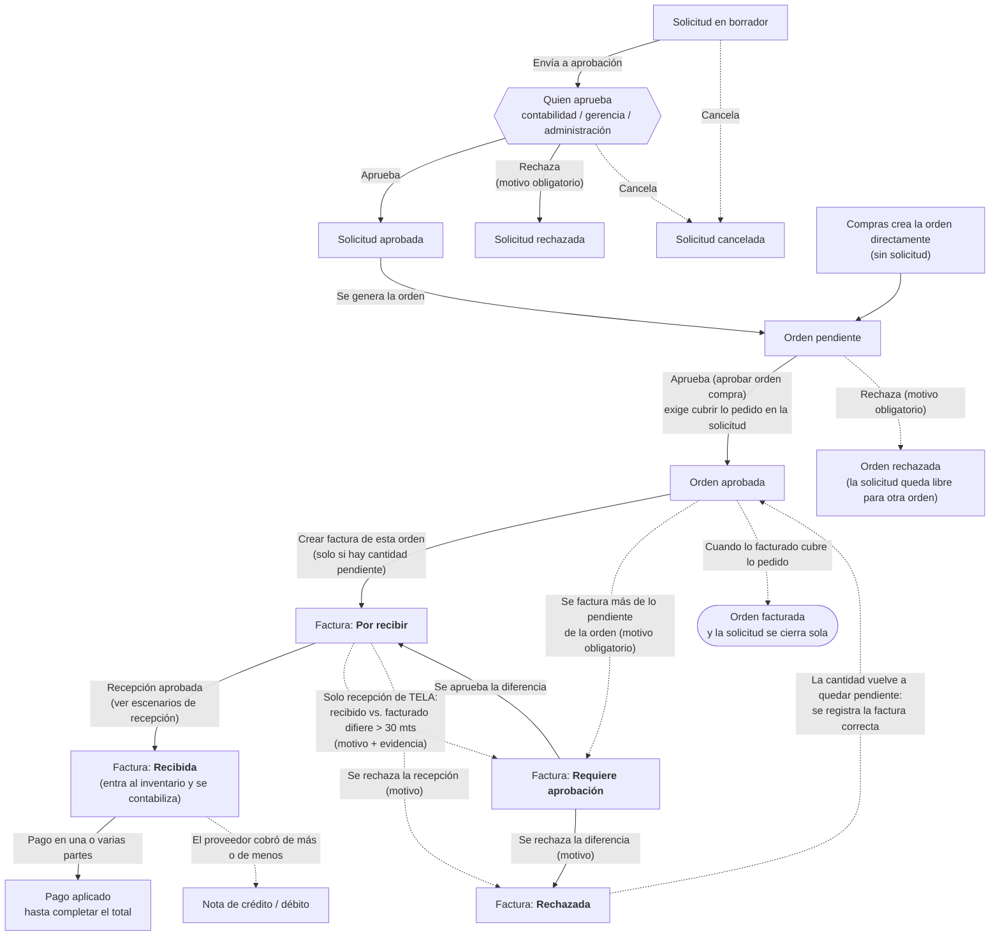

# Diagrama de flujo — Compras (Solicitud → Orden → Factura → Recepción)

**Última actualización:** 2026-09-29

Describe el proceso de compras tal como funciona hoy: los pasos, los estados que ve el usuario, los escenarios posibles y las condiciones que los habilitan o bloquean. Las reglas por estado (qué acción se permite en cada uno y dónde vive cada regla en el código) están en [REGLAS_ESTADOS_COMPRAS.md](../REGLAS_ESTADOS_COMPRAS.md).

## Estados que ve el usuario

### Factura (un solo estado en pantalla)

Internamente la factura guarda dos campos, pero en pantalla se muestra **un único estado** que dice qué falta por hacer. Al pasar el mouse sobre el estado se ve el detalle.

| Estado | Qué significa | Qué hace falta |
|---|---|---|
| **Por recibir** | La factura está registrada y la mercancía aún no llega | Recibir la mercancía |
| **Requiere aprobación** | Hay una diferencia por decidir. Puede venir de dos lados: al **registrar la factura** se facturó más de lo pendiente de la orden, o en la **recepción de tela** lo recibido difiere en más de 30 mts de lo facturado | Que alguien con `gestionar diferencias factura compra` la apruebe o la rechace |
| **Recibida** | La recepción se aprobó; entró al inventario | Pagar; notas crédito/débito si aplica |
| **Rechazada** | Se rechazó la recepción o se rechazó la diferencia | Nada sobre esta factura; su cantidad vuelve a la orden |

- Una **diferencia aprobada** no es un estado: la factura sigue su camino normal y se marca con un ícono ⓘ junto al total.
- Si la factura no se puede editar, el botón Editar aparece deshabilitado y al pasar el mouse explica por qué.

### Orden

`Pendiente` → `Aprobada` → `Parcialmente facturada` → `Facturada`, o `Rechazada`. Además, "Enviada <fecha>" es una marca (no un estado) que aparece al enviarla por correo.

### Solicitud

`Borrador` → `Pendiente` → `Aprobada` → `Procesada` (cerrada porque todo se facturó), o `Rechazada` / `Cancelada`.

## Escenarios posibles

| Escenario | Qué pasa |
|---|---|
| **Una orden, una factura exacta** | La orden pasa a Facturada y la solicitud se cierra. |
| **Facturación parcial** (varias entregas) | Cada factura descuenta del pendiente; la orden queda Parcialmente facturada hasta cubrir lo pedido. |
| **Facturar de más** | Se permite solo con motivo; la factura queda en Requiere aprobación y la orden, parcialmente facturada, hasta que se decida. |
| **Pendiente en 0** | Ya no se puede crear otra factura para esa orden (la opción desaparece y el servidor la rechaza), aunque haya una diferencia por decidir. |
| **Factura rechazada** (recepción o diferencia) | No cuenta como facturada: la orden recupera el pendiente y se registra la factura correcta. |
| **Borrar una factura** (solo Por recibir, sin diferencia) | La orden vuelve a Aprobada o Parcialmente facturada y la solicitud se reabre si estaba cerrada. |
| **Cerrar la orden sin facturar el resto** | Solo si está parcialmente facturada, con motivo; queda Facturada y no se reabre. |

La factura en sí **no tiene tolerancia**: solo se compara contra el pendiente de la orden. La tolerancia de 30 mts pertenece a la **recepción de tela** (siguiente sección).

## Escenarios de recepción

La recepción no es un documento aparte: se hace sobre la factura **Por recibir** desde la pantalla de Recepción. Una factura puede tener ítems de tela, ítems generales (bodega) o ambos; cada tipo se recibe a su manera.

### Tela (rollo a rollo)

Se registra cada rollo: longitud (mts), ancho (m), ubicación, fecha y observaciones. El número de rollo (RL) lo asigna el sistema. El inventario **no** se carga al registrar el rollo, sino al aprobar la recepción.

**Estado de cada rollo durante la recepción**

| Estado del rollo | Cuándo | Qué se puede hacer |
|---|---|---|
| Sin observación | La línea está dentro de ±30 mts y el ancho dentro de tolerancia | Editar (clic en la celda), borrar, rechazar por calidad |
| **En revisión** | La línea queda fuera de ±30 mts (o el ancho queda más de 0,05 m por debajo del pedido) | Aprobar diferencia o rechazar (motivo obligatorio) |
| **Aprobado con diferencia** | Se aceptó pese a la diferencia | Entra al inventario al aprobar la recepción |
| **Rechazado** | Se rechazó (motivo obligatorio) | Queda **restringido**: no entra al inventario y espera una nota crédito |

**Escenarios**

| Escenario | Qué pasa |
|---|---|
| **Dentro de tolerancia** (lo recibido difiere ≤ 30 mts de lo facturado por ítem) | Se aprueba la recepción directo; los rollos entran al inventario y la factura queda **Recibida** y se contabiliza. |
| **Fuera de tolerancia** (faltan o sobran > 30 mts en un ítem) | 1) Quien recepciona reporta la diferencia con motivo y evidencia → la factura pasa a **Requiere aprobación**. 2) Otra persona con `gestionar diferencias factura compra` la aprueba o la rechaza. 3) Cada rollo **En revisión** se aprueba o se rechaza. 4) Recién ahí se aprueba la recepción. |
| **Diferencia rechazada** | La factura queda **Rechazada**, no admite más rollos y su cantidad vuelve a la orden. |
| **Rollo defectuoso** (aunque la línea esté en tolerancia) | Se rechaza ese rollo con motivo; queda restringido. |
| **Rollos rechazados** | Tras aprobar la recepción, se crea una **nota crédito** que los cubre. Mientras no se apruebe, el pago de la factura retiene el valor de esos rollos. Al aprobarse la nota, los rollos se dan de baja. |
| **Recibir de más al registrar** | Solo se avisa (no bloquea); al aprobar se exigirá la diferencia si supera 30 mts. |
| **Corregir un rollo** | Mientras la recepción esté abierta: clic en la celda de la tabla "Rollos recibidos". Un rollo con decisión (aprobado con diferencia, rechazado o con nota crédito) ya no se edita. |
| **Rechazar toda la recepción** | Con motivo, mientras esté Por recibir y **sin** una diferencia en Requiere aprobación. La factura queda **Rechazada**. |
| **Añadir rollos tras aprobar** (excepción: un rollo que llegó y no se registró) | Solo con `agregar rollos recepcion aprobada` (admin/superadmin), con **motivo obligatorio** (queda en el historial de la recepción). Se permite si la línea queda dentro de ±30 mts o si el rollo acerca lo recibido a lo facturado (completar un faltante); si la saca de la tolerancia se bloquea. El rollo entra directo al inventario. Una entrega adicional real va en una **factura nueva**. |
| **Aprobar dos veces** | No se permite: no se duplica el inventario. |

**La aprobación de la recepción es un cierre.** Después de aprobar, la única excepción es añadir un rollo omitido con motivo y sin salirse de la tolerancia; cualquier otra corrección de cantidades va por ajuste de inventario, para que inventario, asiento contable y pagos sigan cuadrados.

Detalle técnico (cálculos, retención, asientos) en [RECEPCION_ROLLOS_TOLERANCIA_Y_NOTAS_CREDITO.md](../RECEPCION_ROLLOS_TOLERANCIA_Y_NOTAS_CREDITO.md).

### Ítems generales (bodega)

Se reciben por **rondas**: en cada ronda se indica la cantidad recibida y la bodega de cada línea. Cada ronda carga el inventario al registrarla.

| Escenario | Qué pasa |
|---|---|
| **Recepción completa o parcial** | Se registran una o varias rondas hasta completar lo facturado; la pantalla muestra lo recibido y lo pendiente por línea. |
| **Recibir de más** | Se permite solo con motivo de la sobre-recepción. |
| **Recibir de menos** | Se permite; **no hay validación de tolerancia** para ítems generales. |
| **Corregir una ronda** | Solo **antes de aprobar** la recepción, quien tenga `aprobar recepcion tela` cambia la cantidad o la bodega. El sistema revierte el movimiento de inventario anterior y crea uno nuevo; se puede corregir varias veces. |
| **Aprobar la recepción** | Cierra la recepción; la factura queda **Recibida**. Después no se registran ni se corrigen rondas: cualquier corrección se hace con un **ajuste de inventario**. |
| **Rechazar la recepción** | Igual que en tela: motivo obligatorio y la factura queda **Rechazada**. |

### Factura mixta (tela + ítems generales)

Cada tipo de ítem se recibe con su método; la recepción se aprueba una sola vez para toda la factura y exige que la parte de tela cumpla sus condiciones.

## Qué es obligatorio o está bloqueado en cada paso

| Paso | Obligatorio / bloqueado | Opcional |
|---|---|---|
| Crear la solicitud | Descripción; al menos un artículo | Artículo escrito "a mano"; foto por artículo |
| Aprobar / rechazar la solicitud | Motivo al rechazar | — |
| Crear la orden | N° de pedido del proveedor; fecha de entrega; artículos del catálogo | — |
| Aprobar la orden | Lo ordenado debe cubrir lo pedido en la solicitud | — |
| Enviar la orden por correo | Solo aprobada o en facturación; el proveedor debe tener correo | — |
| Registrar la factura | N° de factura del proveedor (no repetido por proveedor); proveedor; artículos del catálogo; la orden debe tener pendiente; si supera el pendiente, motivo | Retenciones |
| Editar / borrar la factura | Solo Por recibir y sin diferencia (ni pendiente, ni aprobada, ni rechazada) | — |
| Aprobar la recepción | No debe estar ya aprobada; diferencias aprobadas; rollos en revisión resueltos | — |
| Rechazar la recepción | Motivo; no se puede con una diferencia en Requiere aprobación | — |
| Aprobar / rechazar una diferencia | Permiso `gestionar diferencias factura compra`; motivo al rechazar | Nota al aprobar |
| Registrar el pago | No superar el saldo; una factura rechazada no admite pagos | Pago en partes |
| Nota de crédito / débito | La factura debe estar Recibida | — |

**Cantidades y precios:** máximo 2 decimales en todo el flujo (solicitud, orden, factura, recepción y rollos).

**Fechas:** la recepción guarda fecha y hora y se muestra en hora local.

## Trazabilidad

Solicitud, orden y factura muestran el mismo panel con la cadena completa (solicitud → órdenes → facturas → recepción), el estado y las fechas de cada eslabón. Cada documento se abre en una pestaña nueva; si el usuario no tiene permiso sobre alguno, se ve sin enlace.

## Cómo funciona por dentro (aclaraciones)

- **Estado de la orden según lo facturado** (una sola función, `recalculateOrderStatus`): cuentan solo facturas válidas (no rechazadas ni con diferencia rechazada). Sin facturas → Aprobada; lo facturado cubre lo pedido en cada ítem → Facturada; falta cantidad o hay una diferencia en Requiere aprobación → Parcialmente facturada. Se recalcula al crear, borrar o rechazar una factura y al decidir una diferencia. Recibir la factura no cambia la orden.
- **El stock de tela** entra al inventario al aprobar la recepción, no al registrar cada rollo.
- **Tolerancia:** existe solo en la **recepción de tela**: ±30 mts por ítem (de más o de menos) frente a lo facturado. La factura no tiene tolerancia y los ítems generales tampoco.
- **Quién aprueba órdenes:** quien tenga el permiso `aprobar orden compra`, sea cual sea su rol (gerencia, administración u otro); se asigna desde la administración de roles.
- **Rechazar una orden:** solo mientras está pendiente; no se elimina (conserva el consecutivo) y su solicitud queda disponible para otra orden.
- **Facturar desde la orden** es un atajo de pantalla: abre la factura con la orden precargada. No existe una conversión automática orden → factura.

## Pendiente y decisiones abiertas

- **Reaperturas:** no existen para solicitud rechazada/cancelada, orden cerrada ni recepción rechazada; hoy se crea un documento nuevo.
- **Devoluciones al proveedor:** funcionalidad pendiente. Hoy los rollos rechazados o una diferencia rechazada se cubren con nota crédito, sin registrar la devolución física.
- **`convertir-a-orden` (solicitud):** endpoint sin uso en pantalla; crea órdenes sin fecha de entrega ni N° de pedido del proveedor.
- **Alcance por rol** (`ver propios/area ordenes compra`): sembrado pero sin uso.
- **Estado `received`:** ninguna pantalla lo produce (la recepción deja `approved`); en pantalla ambos se ven como Recibida.
