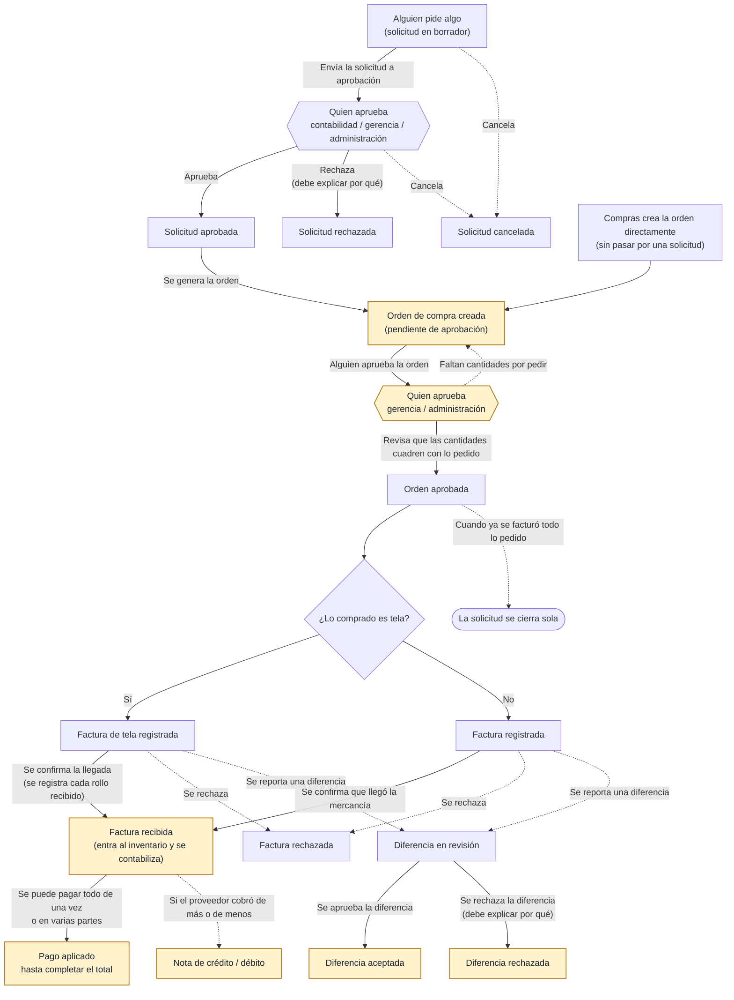

# Diagrama de flujo — Compras (Solicitud → Orden → Factura)

Proceso de compras tras las correcciones de la revisión del módulo. Los pasos resaltados en amarillo son los que cambiaron. Las correcciones de la sección "Qué cambió" ya están aplicadas; lo que sigue pendiente está en "Pendiente y decisiones abiertas".

## Variantes que existen además del camino principal

- **Orden sin solicitud previa**: compras también puede crear una orden directamente, sin que nadie haya pedido nada antes.
- **Varias facturas para una misma orden**: una orden puede facturarse de a poco; la solicitud recién se cierra sola cuando ya se facturó todo.
- **Factura normal vs. factura de tela**: es una pantalla distinta con un paso extra (registrar cada rollo recibido: cantidad, ancho, ubicación y fecha), pero sigue el mismo camino de fondo.
- **Nota de crédito o débito**: si después de recibida la factura el proveedor cobró de más o de menos, se genera una nota aparte contra esa factura.
- **Pago en varias partes**: una factura no tiene que pagarse completa de una sola vez; se pueden ir registrando abonos hasta llegar al total.

## Qué es obligatorio en cada paso

| Paso | Es obligatorio | Es opcional |
|---|---|---|
| Crear la solicitud | Descripción; al menos un producto o artículo | El artículo puede escribirse "a mano" aunque no esté en el catálogo; se puede adjuntar una foto por artículo |
| Aprobar / rechazar la solicitud | Si se rechaza, hay que escribir el motivo | — |
| Crear la orden de compra | Número de pedido del proveedor; fecha de entrega prometida; cada artículo debe existir en el catálogo (aquí ya **no** se acepta un artículo "a mano") | — |
| Aprobar la orden | El sistema exige que lo ordenado cubra completo lo que se pidió en la solicitud; si falta cantidad, no deja aprobar | — |
| Registrar la factura | Número de factura del proveedor; un proveedor de la lista o, si no está registrado, al menos su nombre; cada artículo debe existir en el catálogo | Retenciones, si aplican |
| Recibir la factura | — | Si es tela: registrar cada rollo recibido (cantidad, ancho, ubicación, fecha) |
| Aprobar / rechazar una diferencia | Si se rechaza, hay que explicar por qué | Al aprobarla, la explicación no es obligatoria |
| Registrar el pago | El monto no puede superar el saldo pendiente de la factura; una factura rechazada no admite pagos | Se puede pagar en una sola vez o en varias |
| Nota de crédito / débito | La factura debe estar recibida o aprobada antes de poder generarle una nota | — |

Una vez que una solicitud, orden o factura llega a un estado "cerrado" (aprobada, recibida, etc.), ya no se puede editar libremente: hay que corregirla mediante los pasos del flujo (justificar diferencia, nota de crédito/débito), no cambiando el registro original.

## Qué cambió (aplicado)

- **Aprobar la orden de compra**: el endpoint fallaba siempre (usaba una variable inexistente) y además solo dejaba aprobar al comprador. Ahora aprueba quien tenga el permiso `aprobar orden compra`. Desde el listado de órdenes hay una acción "Aprobar orden" para las pendientes.
- **Facturar una orden**: nueva acción "Facturar orden" en el listado; abre la factura de compra con la orden ya seleccionada (`/gastos/facturas-compra?orden=ID`, que abre el diálogo de factura), respetando la facturación parcial. Las órdenes de tela se facturan desde "Facturas de tela", que también lista las órdenes parcialmente facturadas y precarga la cantidad pendiente.
- **Recibir la factura**: el estado `received` había desaparecido del enum de la base de datos (migración `2026_05_24_200000`), lo que hacía fallar la recepción de facturas normales; se restauró con una migración nueva. Las facturas de tela ya recibidas (`approved`) ya no se pueden editar ni borrar, y una factura recibida ya no se puede rechazar.
- **Borrar una factura**: la orden ya no vuelve a `pending`; vuelve a `approved` si no quedan facturas, o a `partially_invoiced` si quedan otras, y la solicitud que se había cerrado se reabre.
- **Cerrar una orden manualmente** (`cerrar`): ahora también cierra la solicitud cuando todas sus órdenes quedan facturadas.
- **Registrar el pago (rutas legacy `/gastos/pagos`)**: ahora exigen los permisos de comprobantes de egreso (`ver` / `crear comprobantes egreso`) en vez de quedar abiertas a cualquier usuario autenticado.
- **Nota de crédito / débito**: una nota aprobada ya no se puede editar ni borrar.
- **Correos**: "Enviar por correo" de órdenes y de facturas de tela llamaba a rutas que no existían (404); ya apuntan a rutas válidas.
- Acciones de solicitudes y órdenes que se mostraban sin el permiso correspondiente ahora se ocultan.

## Cómo funciona realmente (aclaraciones frente a versiones anteriores de este documento)

- **Recepción de tela (rollo a rollo)**:
  - El stock entra al inventario solo al marcar la recepción completa (aprobar), no al registrar cada rollo.
  - Quien recepciona (permiso `aprobar recepcion tela`) marca la recepción completa. Si a ningún ítem le faltan más de **30 mts** respecto a lo facturado, se aprueba y entra el inventario. Lo recibido de más no se restringe: entra al inventario.
  - Si a algún ítem le faltan más de 30 mts (la restricción es solo hacia abajo), no se puede aprobar directo: se registra la diferencia con su motivo (`reportar-diferencia`) y queda pendiente hasta que **otra persona con permiso `gestionar diferencias factura compra`** la apruebe (o la rechace con motivo). Solo entonces se puede marcar la recepción completa. Una diferencia rechazada bloquea la recepción; se gestiona por fuera con rechazo/nota de crédito o devolución (aún no implementado).
  - Al registrar un rollo solo se **alerta** (no bloquea) cuando lo recibido supera lo facturado en más de 30 mts; el diálogo del rollo muestra en vivo el faltante o excedente.
  - Con la recepción aprobada, añadir más rollos solo puede quien tenga `ajustar telas rollos`; esos rollos entran directo al inventario. Editar o borrar rollos sigue bloqueado.
- **Una orden nace pendiente** (también al crearla desde una solicitud) y debe aprobarse con el permiso `aprobar orden compra` antes de poder facturarse. La regla de cobertura de cantidades se evalúa en ese paso. Una orden puede tener varias facturas (entregas parciales o facturas separadas); la solicitud no se divide en varias órdenes.
- **Estado de la orden según lo facturado** (una sola función, `recalculateOrderStatus`): cuentan solo facturas válidas (no rechazadas ni con diferencia rechazada). Sin facturas queda aprobada; cuando lo facturado cubre lo pedido en cada ítem pasa a facturada (facturar de más no lo impide); si falta cantidad o hay una diferencia pendiente queda parcialmente facturada. Se recalcula al crear, borrar o rechazar una factura y al aprobar o rechazar una diferencia. Recibir la factura no cambia la orden: la orden sigue abierta mientras falte por facturar y se cierra al cubrirse lo pedido o con el cierre manual con motivo (`editar ordenes compra`, solo si está parcialmente facturada), que no se reabre.
- **Facturar más de lo pendiente** se permite solo con motivo: la factura nace pendiente de aprobación de la diferencia (`gestionar diferencias factura compra`) y hasta entonces la orden queda parcialmente facturada. El servidor lo exige aunque el formulario no lo pida.
- **La solicitud** se cierra cuando todas sus órdenes no rechazadas están facturadas y se reabre si alguna deja de estarlo.
- **Estados de orden**: `pending`, `approved`, `partially_invoiced`, `invoiced`, `rejected`. No existe `sent`, `processed` ni `cancelled` como estado de orden (`processed` solo existe en la solicitud: cerrada porque todo lo pedido ya se facturó).
- **Rechazar una orden**: solo mientras está `pending`, con el permiso `aprobar orden compra` y motivo obligatorio (aprobar no pide motivo). La orden rechazada no se elimina (se conserva el consecutivo) y su solicitud queda disponible para generar otra orden.
- **Orden enviada al proveedor**: no es un estado sino una marca (`sent_at`) que se registra al enviar la orden por correo; el listado muestra "Enviada <fecha>" bajo el estado.
- **Estados de factura**: `pending_receipt`, `received`, `rejected`; la recepción de tela deja la factura en `approved`.
- **Notas crédito/débito**: solo `pending` y `approved`.
- **Diferencia rechazada**: la orden se mantiene `partially_invoiced` hasta gestionar la nota de crédito.
- La solicitud se cierra (`processed`) cuando todas sus órdenes no rechazadas están facturadas, ya sea por facturación completa o por cierre manual.

## Pendiente y decisiones abiertas

- **Facturas de tela recibidas (`approved`)**: el estado lo fija quien recepciona desde la pantalla de recepción. Su relación con pagos y contabilización queda fuera de alcance junto con el registro de pagos.
- **Quién aprueba órdenes**: el permiso `aprobar orden compra` está sembrado solo para gerencia; falta confirmar si administración también debe tenerlo.
- **`convertir-a-orden` (solicitud)** y **`convert-to-invoice` (orden)**: endpoints existentes sin uso en pantalla; `convertToOrder` crea órdenes sin fecha de entrega ni N° de pedido del proveedor.
- **Rechazo de diferencia y devoluciones**: no hay flujo completo de devolución/nota de crédito desde la recepción; hoy una diferencia rechazada solo bloquea la recepción.
- **Permisos de recepción**: cada acción tiene su permiso específico (`aprobar recepcion tela`, `gestionar diferencias factura compra`, `ajustar telas rollos`) y se asigna a los roles desde la administración de roles; la asignación actual por rol no se modificó.
- **Registro de pagos**: fuera de alcance de esta revisión.
- Alcance por rol (`ver propios/area ordenes compra`) sembrado pero sin uso; aprobar/rechazar/cancelar solicitudes no valida el alcance del usuario.
