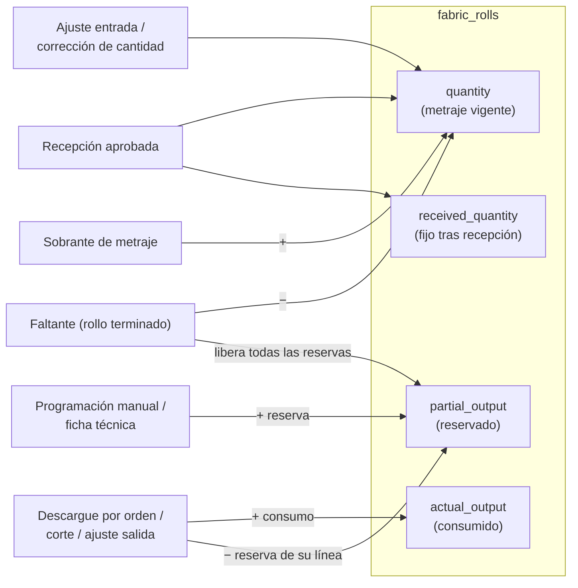
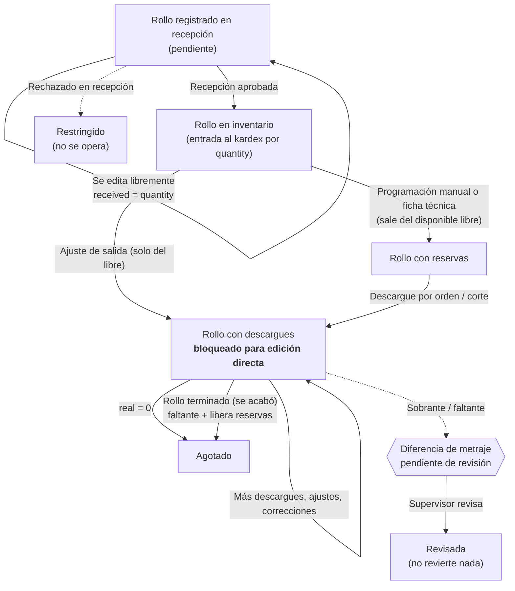
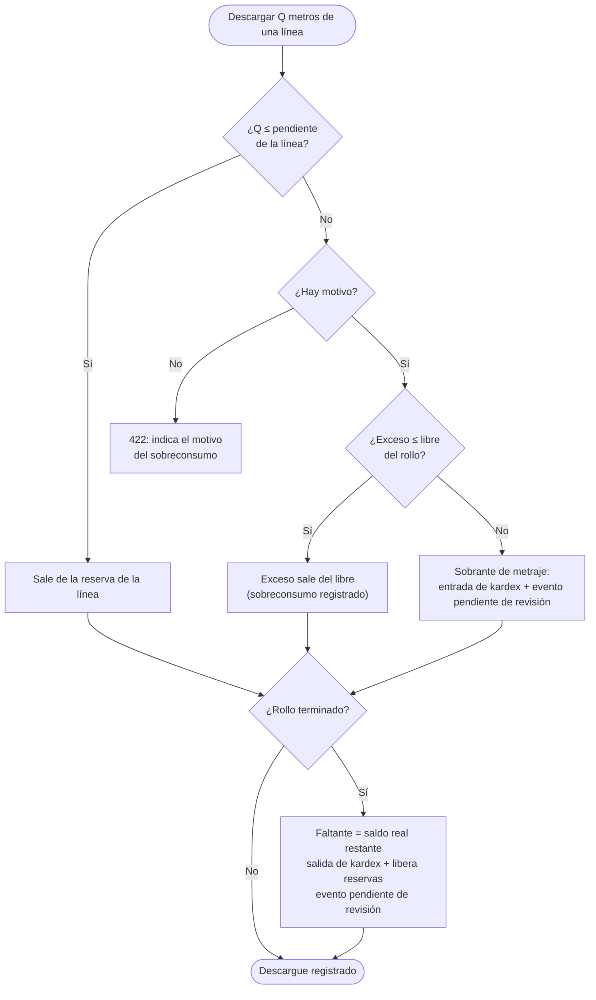
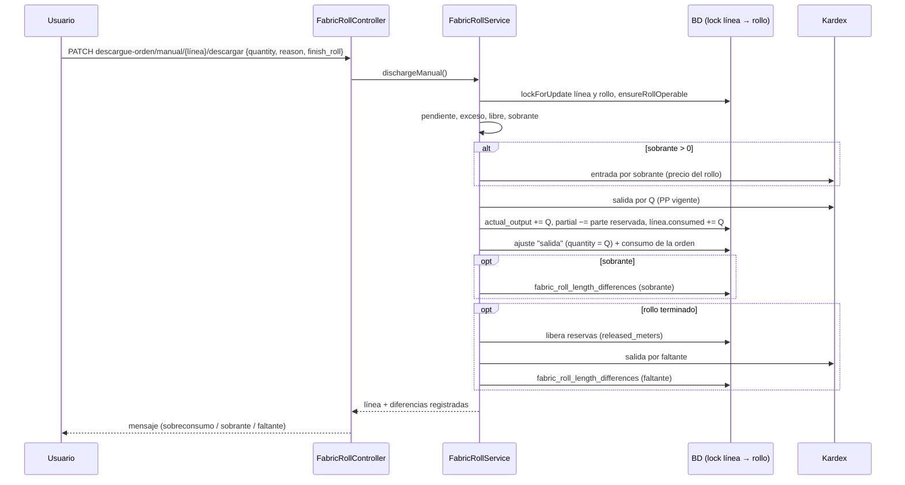
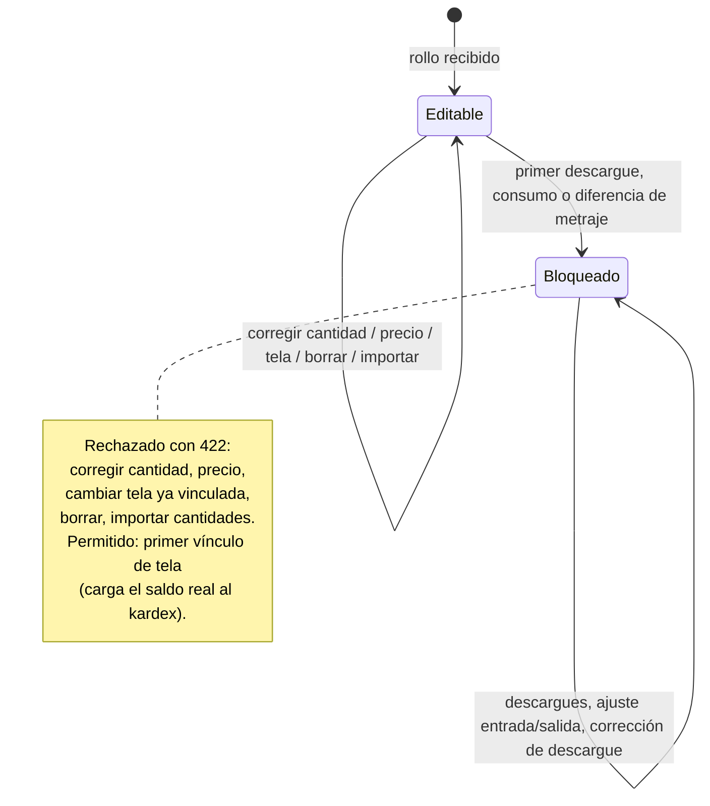

# Rollos de tela — saldos, descargue y diferencias de metraje

**Última actualización:** 2026-09-29

Este documento explica cómo se calcula el stock de un rollo, qué flujos lo modifican, qué pasa cuando se descarga más o menos de lo registrado y por qué un rollo con descargues ya no se edita directamente. Al final están las fallas encontradas en la revisión del flujo y cómo se corrigió cada una.

Código principal: `app/Services/Textil/FabricRollService.php`. Las fórmulas están en `app/Support/Textil/FabricRollBalance.php`.

---

## 1. Saldos de un rollo

| Columna | Qué es | Quién la cambia |
|---|---|---|
| `received_quantity` | Metros recibidos contra la factura. Sigue a `quantity` mientras la recepción está abierta y **queda fija al aprobarla**. | Recepción |
| `quantity` | Metraje **vigente**: recibido + sobrantes − faltantes ± ajustes | Recepción, ajuste de entrada, corrección de cantidad, diferencias de metraje, importación |
| `actual_output` | Metros consumidos (descargados) | Descargues (manual, corte y ajuste de salida) y sus correcciones |
| `partial_output` | Metros **reservados** por programaciones pendientes | Programación manual, ficha técnica, descargues, rollo terminado |

**Fórmulas únicas** (`FabricRollBalance`):

```
real  = quantity − actual_output                   lo que físicamente queda en el rollo
libre = quantity − actual_output − partial_output  lo que se puede tomar sin tocar reservas
```

**Reserva comprometida.** `partial_output` debe ser igual a la suma de reservas pendientes (`FabricRollBalance::committedByRoll()`):

- **Ficha técnica:** `programado − liberado por el corte` (`fabric_roll_programming_lines.released_meters`).
- **Manual:** `programado − consumido − liberado al terminar el rollo` (`manual_roll_programmings.released_meters`).

Hoy usan estas fórmulas el listado, el Resource, el reporte, las validaciones, el reset de ficha técnica, la importación y los comandos `rolls:recalibrar-partial` y `textil:audit-roll-balances`.



---

## 2. Ciclo de vida del rollo



Solo un rollo **aprobado y sin rechazo pendiente** se puede reservar, descargar o ajustar (`ensureRollOperable`). Antes, un ajuste sobre un rollo pendiente creaba un movimiento de kardex, y al aprobar la recepción se cargaba otra vez la cantidad completa. Esos metros quedaban contados dos veces.

---

## 3. Descargue por orden: sobreconsumo, sobrante y faltante

La cantidad registrada de un rollo (la que llegó o la que se creó) no es confiable: el metraje real puede ser mayor o menor. El descargue admite las dos cosas, siempre con un evento trazable.

| Situación | Qué pasa | Requisito |
|---|---|---|
| Descarga ≤ lo pendiente de la línea | Sale de la reserva de la línea | — |
| Descarga > lo pendiente (**sobreconsumo**) | El exceso sale del disponible **libre** del rollo. **Nunca** de reservas de otras órdenes. | Motivo obligatorio |
| El libre no alcanza (**sobrante**) | El rollo trae más tela de la registrada: se crea el evento `sobrante` con su entrada de kardex, sube `quantity` y **no cambia** `received_quantity` | Motivo obligatorio |
| **Rollo terminado** (check en el descargue) | Tras descargar, lo que el sistema todavía tiene es `faltante`: salida de kardex, `quantity` baja y real = 0. Se liberan todas las reservas del rollo (quedan listadas en el evento). El faltante **no** es consumo de la orden. | Motivo obligatorio |



### Transacción del descargue



Cualquier error del kardex (stock insuficiente, período cerrado, ítem sin bodega) cancela toda la transacción y vuelve como error de validación. Antes daba 500 o se omitía en silencio.

### Corrección de un descargue

- La cantidad **vigente** del evento vive en `fabric_roll_adjustments.quantity` y se actualiza con cada corrección. La corrección se registra aparte (`type = correction`, `corrects_adjustment_id`).
- El kardex se ajusta por la **diferencia**, con un movimiento propio de la corrección. El movimiento original no se toca.
- Si la corrección baja el consumo de un descargue que había registrado sobrante, ese sobrante se revierte con un evento inverso (`reverses_id`).
- El consumo reportado a la orden (`production_roll_consumptions`) sigue al descargue corregido.
- Una corrección que deja la línea por encima de lo programado exige motivo.

### Revisión de diferencias de metraje

Se hace en la pantalla **Kardex de Telas → Diferencias de metraje** (`/kardex-telas/diferencias-metraje`), con el permiso `revisar diferencias metraje telas`, que por defecto tienen admin y superadmin.

- La lista muestra rollo, tela, recibido → vigente, orden, factura/proveedor, motivo y quién lo registró. Sirve para reclamar al proveedor.
- La revisión **no revierte** nada: si hubo un error, se corrige el descargue, y esa corrección genera su propio evento.
- El evento es inmutable. El modelo impide editarlo o borrarlo, salvo los campos de la revisión.

---

## 4. Consumo de corte (ficha técnica)

`PUT control-de-lotes/{order}/consumo-telas-corte` delega en `FabricRollService::saveCutConsumption()`:

- **Idempotente:** por rollo aplica solo la diferencia contra lo que el corte ya registró para esa OP (suma de `production_roll_consumptions` con `source = cut`).
- **Liberación de la reserva de la ficha:** se libera lo que la ficha técnica de la OP todavía reservaba en el rollo (`programado − liberado`), leído de la base y no de `meters_per_roll` que envía el cliente. Queda marcado en `released_meters`, así que no se libera dos veces.
- Si el consumo supera el disponible del rollo, se registra un sobrante (con motivo automático).
- **Último descargue** (`ultimo_descargue`): el saldo que queda es faltante y se liberan las reservas del rollo.
- Solo se reemplazan los consumos del corte. Los de ajustes o descargues manuales de la misma OP se conservan.
- Un código de rollo inexistente con consumo devuelve 422. Antes se ignoraba.

Editar o borrar una línea de ficha técnica solo mueve la reserva **pendiente** de la línea (`FabricRollService::syncSheetReservations()`). Esa lógica es la misma para los dos controladores que guardan la ficha.

---

## 5. Bloqueo de edición tras descargue

Un rollo **tiene descargues** (`FabricRollService::hasDischarges()`) si cumple cualquiera de estas condiciones:

- tiene un ajuste `salida`;
- tiene un consumo en `production_roll_consumptions`;
- tiene una diferencia de metraje.



- `update()` (recepción) nunca escribe `partial_output` ni `actual_output`: salieron de los requests. Un rollo sin factura no pasa por `update()`.
- Borrar un rollo es un borrado lógico (`SoftDeletes`) y queda bloqueado si tiene reservas. Si el rollo está recibido, su saldo real sale del kardex con un movimiento de baja.

---

## 6. Flujos que modifican el rollo (estado actual)

| Flujo | Lock | Valida contra | Kardex | Traza |
|---|---|---|---|---|
| Programación manual | Sí | Disponible libre, rollo operable | — | Ajuste `correction` |
| Descargue manual | Sí | Pendiente + libre, motivo si hay exceso | Entrada del sobrante, salida del consumo, salida del faltante | Ajuste `salida` + consumo + diferencias |
| Corrección de descargue | Sí | Cantidad vigente del evento; motivo si queda por encima de lo programado | Movimiento por la diferencia | Ajuste `correction` enlazado |
| Corte (BatchControl) | Sí | Diferencia contra lo ya registrado | Salida o entrada por la diferencia, sobrante, faltante | Ajustes `cut_consumption::{op}` |
| Ficha técnica (guardar o borrar líneas) | Sí | Disponible libre por lo pendiente | — | — |
| Ajuste general entrada/salida | Sí | Salida solo del libre, rollo operable | Sí | Ajuste `entrada`/`salida` |
| Corrección de cantidad | Sí | Sin descargues; no queda por debajo de consumido + reservado | Por la diferencia | Ajuste `correction` |
| Importación de cantidades | Sí (por fila) | Sin descargues; reserva ≤ real; piso de lo comprometido | Por la diferencia del saldo real y cambio de ítem | Ajuste `import_update` |
| Vincular o cambiar tela | Sí | Cambiar tela ya vinculada exige que no haya descargues | Entrada del saldo real (primer vínculo) o traslado entre ítems | Ajuste `correction` |

La bodega de un movimiento es la primera asignada al ítem, la misma que eligió la recepción. Si el ítem no tiene bodega, la operación se bloquea: el sistema nunca inventa una.

---

## 7. Fallas encontradas y corrección

| # | Falla | Corrección |
|---|---|---|
| F1 | Una segunda corrección del mismo descargue aplicaba la diferencia contra la cantidad original y revertía otra vez el movimiento original | Cantidad vigente en `fabric_roll_adjustments.quantity`, correcciones enlazadas y kardex por diferencia. Para los datos ya dañados: `textil:audit-roll-balances --apply` |
| F2 | El descargue de corte no bloqueaba ni validaba, ignoraba los errores de kardex, borraba todos los consumos de la OP y liberaba la reserva dos veces | `saveCutConsumption()` idempotente, `source` en consumos, `released_meters` |
| F3 | Un ajuste o una reserva sobre un rollo pendiente o rechazado quedaba contado dos veces al aprobar la recepción | `ensureRollOperable()` |
| F4 | El ajuste de salida tomaba metros reservados para otras órdenes | Valida contra el disponible libre |
| F5 | La ficha técnica seguía sumando lo que el corte ya había consumido (reset, recalibración, reporte, importación) | `released_meters` y reserva pendiente en todos los cálculos |
| F6 | La importación cambiaba el consumo sin kardex y se caía a mitad (500) | Kardex por el saldo real, cada fila atómica, errores por fila |
| F7 | `update()` ponía en 0 la reserva y el consumo, y un rollo legacy quedaba ligado a una factura | Campos fuera de los requests; `update()` solo para rollos de factura |
| F8 | Metros con decimales ilimitados (desfase entre decimal(10,2) y decimal(20,6)) | `decimal:0,2` en los requests y redondeo en el servicio |
| F9 | Cuatro fórmulas distintas para el disponible | `FabricRollBalance` |
| F10 | El precio de un rollo descargado se podía cambiar y el PP se ponderaba por la cantidad bruta | Precio bloqueado con descargues; PP ponderado por el saldo real; el Resource usa el precio del rollo |
| F11 | Cambiar la tela dejaba el stock en el ítem anterior | Traslado del saldo entre ítems |
| F12 | Borrar un rollo lo eliminaba en cascada con su historial | `SoftDeletes`, bloqueo y baja en el kardex |
| F13 | Bodega con `warehouses()->first()` sin orden | Primera bodega asignada, determinista y estricta |
| F14 | El frontend validaba contra el real en vez del libre y no respetaba los pisos | Mismas reglas en los diálogos |
| F15 | Faltaban permisos en el catálogo | Catálogo completo más el permiso nuevo de revisión |

**Pendientes de decisión (no son cambios de código):**

1. En `RolesAndPermissionsSeeder`, los usuarios de Diseño se crean con el rol `produccion`, que puede descargar. El rol `DISEÑO` ya existe con los permisos correctos. Falta decidir si los usuarios de Diseño pasan a ese rol.
2. `refreshWarehouseItemPP()` reescribe el PP de `warehouse_items` sin movimiento de kardex al cambiar el precio de un rollo. Ahora solo se permite en rollos sin descargues y pondera bien, pero sigue siendo un recálculo fuera del kardex. Falta decidir si pasa a ser un movimiento de revalorización.

---

## 8. Operación y datos existentes

| Comando | Qué hace |
|---|---|
| `php artisan textil:audit-roll-balances` | Reporta rollos con real negativo, reserva distinta de lo comprometido, reserva mayor que el real y descargues dañados por F1 |
| `php artisan textil:audit-roll-balances --apply` | Corrige la reserva y el desvío de F1 con ajustes (y kardex) trazables. Es idempotente. |
| `php artisan inventory:reconcile-fabric-rolls --dry-run` | Compara el kardex por ítem con la suma del saldo real de los rollos |
| `php artisan rolls:recalibrar-partial` | Recalcula `partial_output` desde las programaciones, sin dejar ajuste en el historial. Para producción, preferir `--apply` del comando de auditoría, que sí lo deja. |

**Orden recomendado después de migrar:**

1. `php artisan migrate`.
2. `php artisan db:seed --class=RolesAndPermissionsSeeder`.
3. `textil:audit-roll-balances` y revisar el reporte.
4. `--apply`.
5. `inventory:reconcile-fabric-rolls --dry-run`.

**Migraciones de esta corrección** (`2026_09_29_1000xx`). Cada una trae su backfill:

- `received_quantity`: la cantidad anterior al primer ajuste del rollo.
- `quantity` de los descargues y enlace de las correcciones existentes.
- `released_meters` para las OP que ya registraron corte.
- `source = cut` para los consumos del corte.

Pruebas: `tests/Feature/Textil/FabricRollDischargeFlowTest.php`, además de las suites existentes de Textil y Producción.
